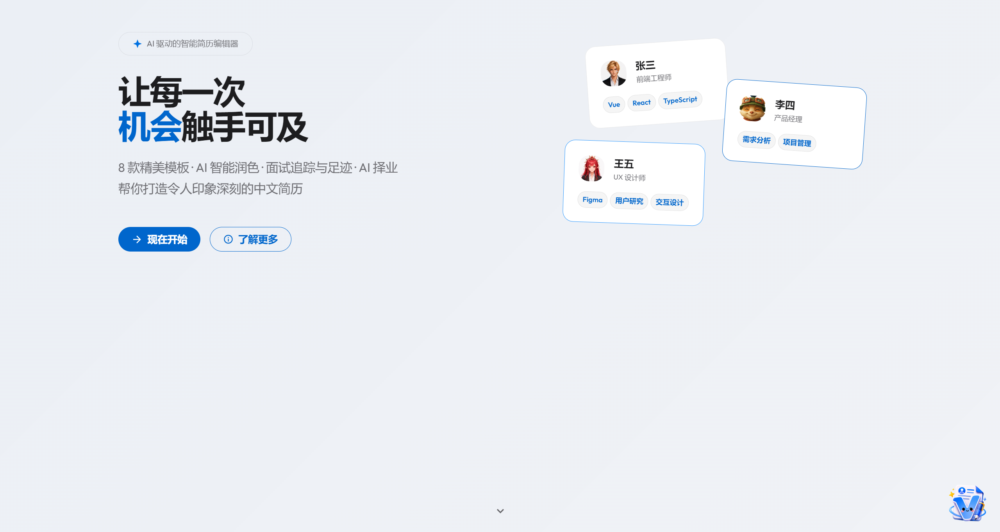
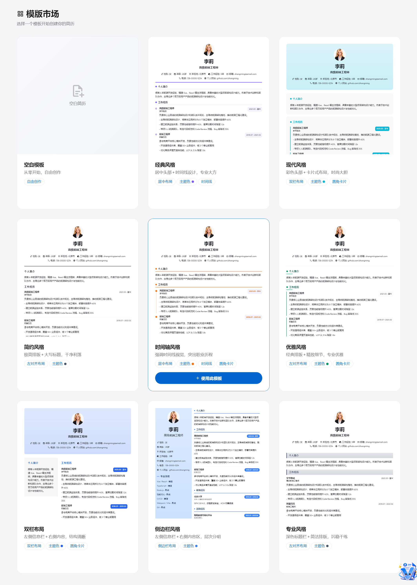
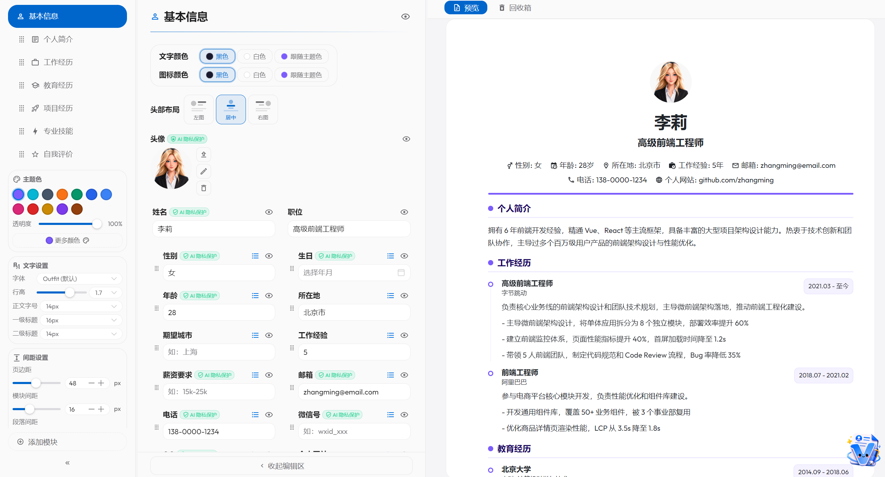
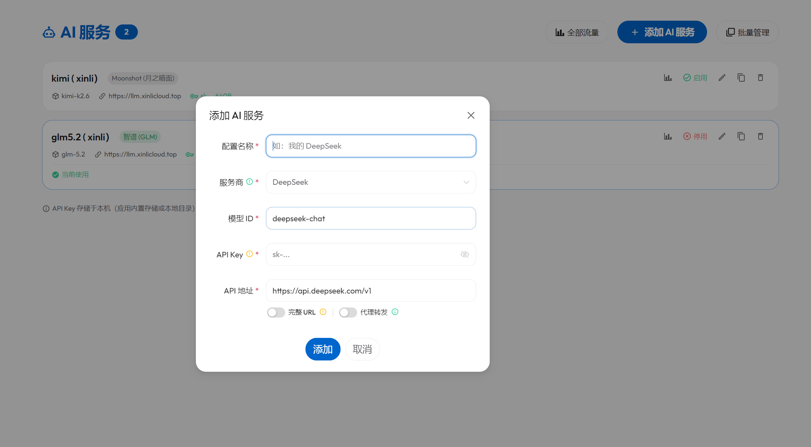
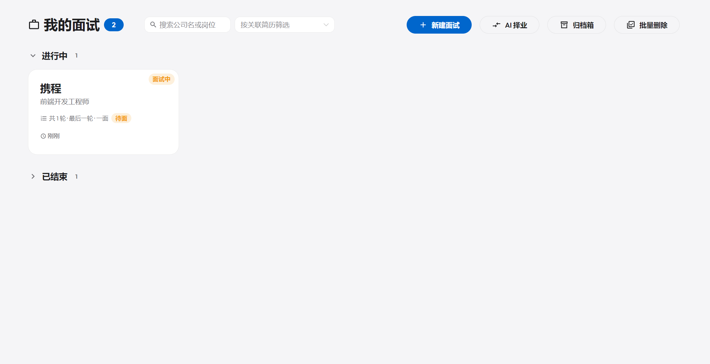
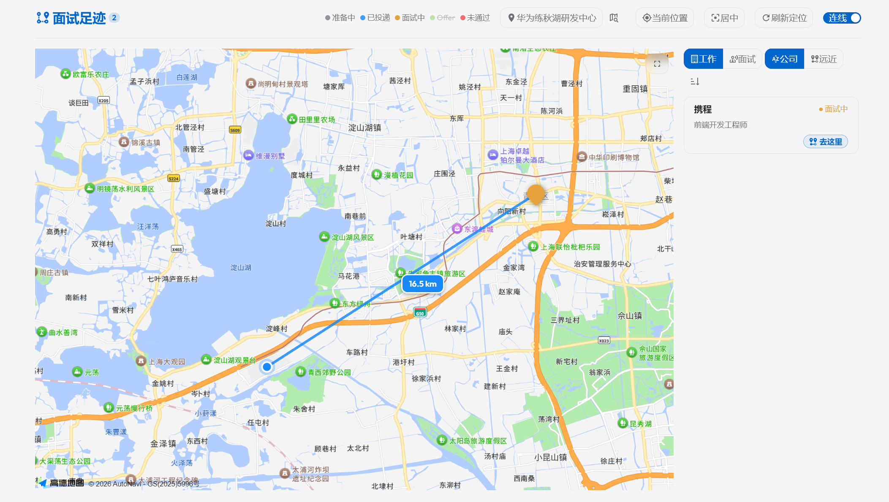
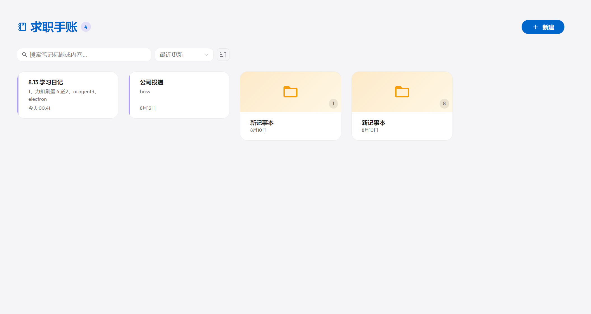

<div align="center">

# 🧾 Vivi Resume

**让每一次机会，触手可及。**

一个纯客户端的中文简历编辑器，把简历、AI、面试、桌宠揉进一个工作台。

[](https://vuejs.org)
[](https://www.typescriptlang.org)
[](https://vitejs.dev)
[](https://pinia.vuejs.org)
[](https://www.naiveui.com)
[](https://tiptap.dev)
[](./LICENSE)
[](./package.json)

**在线预览**：<https://vivi-resume.pages.dev>

</div>

> ⭐ 如果这个项目对你有用，欢迎 **Star**，让更多求职者看到它。

---

**Vivi Resume** 是一个面向个人求职者的纯客户端简历工作台：**9 套模板 + 三列实时编辑 + AI 帮帮（润色 / 评估 / JD 扫描 / 一键优化 / 面试准备 / 智能咨询） + 我的面试追踪 + 高德足迹地图 + Lottie 桌宠 + 求职手账**。所有数据写在浏览器本地（IndexedDB）或你自己绑定的目录，无后端、无需账号、无强制环境变量。

适合：换工作要海投的海投族、想 AI 帮改简历的求职者、记面试复盘的人、想养一只桌宠的人。

---

## 📸 项目展示

### 首页 · Hero

<div align="center">
  
  <br />
  <sub>首页 · 让每一次机会触手可及</sub>
</div>

### 模板市场 · 编辑器

<div align="center">
  
  <br /><sub>9 套模板 · 风格各异，实时预览</sub>
</div>

<br />

<div align="center">
  
  <br /><sub>三列编辑器 · 列宽可拖拽</sub>
</div>


---

## ✨ 核心能力

### 🧱 简历编辑器

- **9 套精美模板** — 空白、经典、现代、简约、时间轴、优雅、双栏、侧边栏（默认）、专业风格；每套独立 CSS 变量，主题色 / 字号 / 行高 / 间距全链路可调
- **三列实时编辑** — 左导航、中编辑、右预览，列宽拖拽；预览区与编辑区滚动同步
- **富文本（Tiptap）** — 加粗 / 斜体 / 列表 / 对齐 / 高亮 / 文字色 / 背景色 / 链接；求职手账内支持图片（Worker 压缩 WebP）+ 待办清单
- **样式个性化** — 12 种预设主题色 + RGBA 取色器；字体 / 行高 / 字号 / 页边距 / 模块间距 / 段落间距全可调
- **模块化管理** — 基本信息之外自由增删排序；条目级卡片可拖拽；隐藏字段在简历里彻底不渲染
- **头部布局** — 居中 / 左对齐 + 照片居左 / 左对齐 + 照片居右；文字 / 图标颜色独立设置
- **Web Worker 图片处理** — 本地头像走 OffscreenCanvas 异步裁剪压缩，不阻塞主线程
- **三种导出格式** — PDF（iframe 打印）/ PNG（modern-screenshot 高清）/ DOCX（docx 库还原样式）；另支持 JSON 完整备份与还原
- **回收站** — 删除的简历可恢复（保留期 7 / 15 / 30 天可配）；编辑器内的卡片 / 模块进"回收箱"，支持字段级合并冲突

### 🤖 AI 帮帮

- **7 种富文本操作** — 润色 / 简化 / 扩展 / 总结 / 帮写 / 翻译 / JD 定制；选中或输入内容后一键触发
- **4 种全局能力** — AI 评估（模块打分 + 三档色值徽章）/ JD 扫描（粘贴 JD 给匹配度 + 优化建议）/ 一键优化（整份简历系统性润色）/ 面试准备（行为题 + 技术题 + 复习要点）
- **AI 智能咨询** — 右下角抽屉，多轮对话 + 历史会话（VS Code 风格标签，10 条上限，可重命名 / 软删除 / 恢复）+ 简历上下文注入 + 文件 / 图片附件（图片走多模态 image_url）；支持常驻侧栏（无遮罩边编辑边问），左右方向可切，宽度可拖
- **AI 智能导入** — 上传 PDF / Word / Markdown，AI 解析为结构化 JSON，Zod 校验，字段视图 + JSON Diff 双视图预览
- **AI 择业** — 面试记录 ≥2 条时启用，多 offer 从薪酬福利、岗位匹配、公司前景、工作地点、面试进度五维横向对比，输出推荐公司 + 置信度 + Markdown 报告
- **AI 隐私保护** — 评估 / JD 扫描 / 一键优化 / 面试准备 / 咨询发送简历前自动脱敏：姓名、联系方式替换为占位符；隐藏的模块 / 字段根本不发送
- **SSE 流式 + 自动续写** — 兼容 OpenAI API 格式，10+ 服务商（DeepSeek、Moonshot、智谱、通义千问、SiliconFlow 等）；输出截断自动续写最多 3 次；1MB 缓冲上限
- **Token 用量追踪** — 累计输入 / 输出 / 总计 token，5 秒防抖持久化

<div align="center">
  
  <br /><sub>AI 服务配置 · 11 个服务商预设 + Token 用量</sub>
</div>


### 🐾 桌宠 v仔

- **Lottie 桌宠** — 屏幕角落悬浮的 Lottie 动画，替代原 AI 咨询 FAB
- **随机说话 + 业务节点** — 定时（默认 60s）随机冒泡；保存 / 导出 / AI 报错 / 进编辑器等节点即时反馈；气泡 5s 自动消失
- **交互** — 单击弹 action 列（AI 咨询入口等）；长按 300ms 拖拽，松手吸附到屏幕左 / 右边缘
- **自定义桌宠** — 设置面板上传素材，三种格式：Lottie JSON / .lottie zip 包 / 图片（GIF / APNG / WebP / PNG / SVG / AVIF）；持久化到 IndexedDB
- **桌宠回收站** — 删除的自定义桌宠进回收站，到期自动清理

### 🗺️ 我的面试

- **面试记录追踪** — 以公司 + 职位为维度记录每次面试，关联简历、JD、薪资、地点、渠道、联系人；支持多轮（轮次类型 / 时间 / 形式 / 面试官 / 会议链接 / 问题 / 回答 / 笔记）
- **三段分区** — 进行中（按下一面紧急度排序）/ 即将面试 / 已结束；分区可折叠；按关联简历筛选；归档箱单独入口
- **状态流转** — 起草 / 已投递 / 面试中 / Offer / 未通过 / 已关闭 六态；状态决定分区归属
- **AI 模拟面试** — 基于关联简历 + JD 生成针对性模拟面试题，结果随面试记录持久化
- **面试复盘** — AI 根据记录的问题与回答生成复盘建议
- **JD 匹配扫描** — 粘贴 JD 分析匹配度，结果缓存到面试记录
- **面试足迹地图** — 基于高德地图标注面试地点并连线测距，支持「工作地点 / 面试地点」模式切换、POI 搜索、定位、全屏；保存面试时后台静默预地理编码回写经纬度
- **AI 择业** — 见上方 🤖
- **批量删除与回收站** — 批量勾选删除，删除进回收站软删除，到期自动清理

<div align="center">
  
  <br /><sub>我的面试 · 三段分区 + 状态流转 + 归档箱</sub>
</div>


<br />

<div align="center">
  
  <br /><sub>面试足迹 · 高德地图标注 + 连线测距</sub>
</div>


### 📓 求职手账

- **记事本 / 笔记二级结构** — 记事本作目录分类，笔记可在记事本内或根级；拖拽笔记到记事本上即可收入
- **富文本 + 图片 + 待办** — Tiptap 编辑，支持工具栏 / 粘贴 / 拖拽插入图片（Worker 压缩 WebP）、内联待办清单
- **关联面试与简历** — 每条笔记可关联多条面试和多份简历，卡片上以徽章显示关联数量
- **搜索与排序** — 按标题或内容搜索，按更新时间 / 创建时间排序
- **自动标题** — 退出编辑时标题为空则自动取正文第一行前 6 字；标题一旦填入永不自动覆盖
- **AI 去简历化** — 手账内 AI 操作走独立 `journal` 场景 prompt，不注入简历上下文
- **回收站 + 双后端** — 软删除 + 到期自动清理；IndexedDB / 目录模式同步

<div align="center">
  
  <br /><sub>求职手账 · 笔记 + 关联面试与简历</sub>
</div>


### 🗂️ Dashboard

- **两列布局** — 侧边导航 + 内容区
- **首页展示** — Hero 主视觉 + 模板轮播 + AI 功能演示 + 特性网格 + 行动号召
- **模板市场** — 用户数据实时预览，每个模板展示自身主题色
- **AI 设置面板** — 11 个服务商预设 + 自定义 endpoint；Token 用量置顶高亮
- **目录模式同步** — 绑定本地目录后自动双向同步，支持进度显示和冲突保护（Chrome / Edge 专属，需 File System Access API）
- **回收站** — 简历 / 桌宠 / 面试 / 手账统一回收站机制，保留期可配置
- **主题切换** — 浅色 / 深色 / 跟随系统三种模式；深色默认玻璃拟态 + 可爱风 UI；监听 `prefers-color-scheme` 自动切换

---

## 🛠️ 技术栈

**Vue 3.4 + TypeScript 5.4 + Pinia 2.1 + Vue Router 4.3 + Vite 6 + Naive UI 2.44 + Tiptap 3.23 + vuedraggable 4.1 + Sass + IndexedDB (idb 8) + marked / turndown / modern-screenshot / docx / lottie-web + 高德地图 JSAPI**

- 流式 AI：兼容 OpenAI API 的 SSE 调用，自动续写，1MB 缓冲
- HTML 安全：isomorphic-dompurify；Markdown ↔ HTML：marked + turndown
- 字符级差异：`diff` 包驱动 AI 结果 Diff 视图
- 离线导出：modern-screenshot 渲 PNG、docx 库出 Word、iframe 打印出 PDF

---

## 🚀 快速开始

### 环境要求

- Node.js ≥ 20（pnpm 10 要求；Vite 6 / Vue 3.4 / TS 5.4 隐含下限）
- 包管理器：**[pnpm](https://pnpm.io)**（项目已锁定 `pnpm@10.32.1`）

### 一条命令启动

```bash
pnpm install
pnpm start
# 打开 http://localhost:5173
```

### 常用脚本

| 命令 | 作用 |
| --- | --- |
| `pnpm start` | 生成图标 + 启动开发服务器 |
| `pnpm build` | 生成图标 + 类型检查 + 生产构建（gzip / brotli 预压缩） |
| `pnpm preview` | 预览构建产物 |
| `pnpm generate-icons` | 从 `@iconify-json` 生成 `src/generated/icon-bundle.ts` |
| `pnpm test` | 运行 Vitest |
| `pnpm lint` | ESLint |

> **可选环境变量**：`.env.example` 仅含 `VITE_CF_TOKEN`（Cloudflare Web Analytics），不填也不影响功能。本项目零强制环境变量、零后端。

### 浏览器要求

- 桌面端 Chrome / Edge / Firefox / Safari 最新两个大版本
- **目录模式**仅 Chrome / Edge 可用（依赖 File System Access API）
- 不做移动端：< 1024px 沿用平板布局

---

## 🔒 数据与隐私

- **纯客户端 SPA**：所有数据写在浏览器本地；没有登录、没有云端、没有账号系统
- **存储后端可选**：
  - **IndexedDB**（`vivi-resume-db` v4，默认）— 简历 / AI 配置 / 咨询会话 / 面试 / 手账 / 自定义桌宠 / 头像 Blob 都在本机
  - **目录模式** — 绑定本地文件夹后双向同步（`resumes/*.json` + `ai-configs/*.json` + `meta.json`），Chrome / Edge 专属
- **AI 隐私保护**：所有发往 AI 的简历内容都经过脱敏——姓名、联系方式等敏感字段替换为占位符；隐藏的模块和字段根本不发送；手账场景独立 prompt，不注入简历上下文
- **首次启动自动迁移**：从旧版 localStorage 自动导入历史简历数据
- **页面隐藏兜底**：`visibilitychange` + `pagehide` + `beforeunload` 三事件，未保存的编辑 best-effort 落盘

---

## 📐 设计特点 + ⚡ 性能优化

| 维度 | 做法 |
| --- | --- |
| 主题 | 浅色 / 深色 / 跟随系统三模，深色默认玻璃拟态 + 可爱风；`useTheme` 单例 + `data-theme` + Naive UI 双套覆盖 + 离散 API 重建 |
| CSS 变量链 | Resume 数据 → `useResumeDocument`(computed) → 模板 `:style` → `base.scss` 读取 `var(--t-xxx)`，全链路响应式 |
| 主题色派生 | `colorUtils.ts` 动态派生标题色 / 标签背景色 / 侧边栏配色，覆盖模板默认 |
| 渲染缓存 | `renderHtml` 200 条 LRU 缓存；`content-visibility: auto` + `contain-intrinsic-size` 优化长简历渲染 |
| 状态管理 | `shallowRef` + dirty flag 替代 `deep watch`，O(1) 判断变更 |
| 自动保存 | 1s 防抖 + 写锁串行；页面隐藏 / 关闭兜底落盘 |
| Proxy 剥离 | 写 IndexedDB 前 `toRaw()` + `structuredClone()`，共享 `toPlain()` helper |
| 代码拆分 | `manualChunks` 拆分 naive-ui、tiptap（9 个子包）、vuedraggable |
| Worker | 单例 `imageProcessor` 处理图片（OffscreenCanvas 编码，CPU 密集），ImageBitmap Transferable 零拷贝 |
| SSE 安全 | 1MB 缓冲上限，截断自动续写最多 3 次 |
| 视觉性能 | backdrop-filter 降级 + `prefers-reduced-motion: reduce` 禁用动画 |
| 编辑器进入 INP | 骨架屏过渡、预览区分帧渲染、AI 弹窗懒挂载、store 并行初始化 |

---

## 🧑‍💻 开发说明

### Sass 自动注入

`vite.config.ts` 通过 `additionalData` 全局注入变量 / 混入：

```scss
// 任何 .scss 文件无需 @use
body {
  background: $bg-secondary;
  @include glass-card;
}
```

### CSS 变量传递链路

```
Resume 数据 (resumeStore)
  → useResumeDocument (computed CSS vars)
    → 模板组件 :style 绑定
      → base.scss / SidebarTemplate.vue 读取 var(--t-xxx)
```

关键变量：`--t-accent`、`--t-line-height`、`--t-body-font-size`、`--t-module-spacing`、`--t-paragraph-spacing`、`--t-max-width`（硬编码 `none`，外边距由 ResumePreview 的 padding 控制）

### 添加新模板

1. `src/config/templates.ts` 加 `TemplateConfig`（含 `style` + `fontDefaults`）
2. `src/components/preview/templates/<id>/<Id>Template.vue` 写组件
3. `ResumeDocument.vue` 的 `TEMPLATE_MAP` 注册

### AI 架构

```
用户操作（润色 / 翻译 / 评估 …）
  → aiConfigStore（选择 AI 服务配置 + Token 用量追踪）
    → aiPrompts（构建 system + user messages）
      → aiService.streamChat（SSE 流式 + 自动续写 + 缓冲区限制）
        → onChunk 回调（实时更新 UI）
          → onUsage 回调（Token 用量防抖持久化）
```

- **数据流**：Tiptap HTML → turndown(Markdown) → AI 流式 Markdown → marked(HTML) → sanitizeHtml → 写回编辑器
- **续写**：检测 `finish_reason: "length"` 后追加 assistant + 「请继续」续写提示，最多 3 次
- **11 个服务商预设**：openai / deepseek / moonshot / siliconflow / openrouter / zhipu / qwen / glm / baichuan / yi / custom。其中 deepseek / moonshot / siliconflow / openrouter / custom 浏览器直调 CORS 友好，其余 6 个走 Vite 开发代理
- **持久化**：评估结果存 `Resume.lastEvaluation`，`saveToStorageNow()` 立即写入

### AI 智能咨询架构

咨询是独立路径，**绕过 `buildMessages`**，直接构造完整 messages 数组调用 `streamChat`：

```
用户提问（可选附简历上下文 + 文件 / 图片附件）
  → consultStore.sendMessage
    → consultPrompts（系统提示 + 简历上下文模板 + 历史压缩摘要）
    → aiService.streamChat
      → 流式 Markdown 回写抽屉对话区
```

- **会话持久化**：`shallowRef` + IndexedDB `consultSessions` store；上限 10 条；assistant 消息立即落盘
- **软删除**：`closed` 标记已从标签栏关闭但保留在历史列表，可点击恢复；空会话关闭时真删除
- **历史压缩**：超阈值调一次非流式 `streamChat` 把旧段压缩为摘要注入前置消息
- **多模态**：`ChatMessage.content` 支持 `string | ContentPart[]`；图片走 `image_url`；文本文件提取纯文本注入
- **常驻侧栏**：`ConsultDrawer` 支持 pin 到左右侧栏，无遮罩边编辑边问

### 桌宠架构

```
DesktopPet.vue（悬浮 + 拖拽吸附 + action 列）
  → usePetRenderer（lottie-web 加载 / 销毁，img 直接 ，加载失败防御）
  → petStore（说话状态汇聚：currentQuote + 定时冒泡 + 暂停）
    → petQuotes.ts（分类话术 + 随机抽取）
  → desktopPets.ts（内置 v仔 + 自定义桌宠内存缓存合并）
```

- **话术系统**：静态话术 + AI 动态话术双路径；`genToken` 防串台；AI 话术 TTL = 字数 × 120ms + 2s；`fillVars()` 替换 `{name}` / `{firstname}` / `{company}`
- **三类提醒定时器**：`idleTimer`（随机冒泡）/ `restTimer`（用眼休息）/ `interviewTimer`（面试临近 30 / 10 分钟两档提醒）三者独立可关

### 模块顺序管理

- `sectionOrder: string[]` — 模块显示顺序
- `hiddenSections: string[]` — 已隐藏 / 删除的模块
- `DEFAULT_SECTION_ORDER` — 默认顺序常量
- `SECTION_CONFIG` — 模块配置（名称 / 图标）

### 代码风格

- TypeScript strict + noUnusedLocals + noUnusedParameters + noFallthroughCasesInSwitch
- Pinia 全部 setup 函数风格
- Vue 3 Composition API + `<script setup>`
- 路径别名 `@/*` → `./src/*`

---

## 📦 项目结构

```
src/
├── components/
│   ├── ai/                # AIButtonGroup / AIResultPreview / 5 个全局弹窗 / ConsultDrawer / DesktopPet
│   ├── common/            # AppHeader / RichTextEditor (Tiptap) / ResizeHandle / FindReplaceBar
│   ├── dashboard/         # SidebarNav / ResumeListPanel / TemplateMarketPanel / AISettingsPanel
│   │                      # InterviewPanel / InterviewFootprintPanel / JournalPanel / TrashPanel
│   ├── editor/            # SectionNavigator / SectionEditor / AddSectionModal / TrashBinPanel
│   │   └── sections/      # 各 section 编辑器组件
│   ├── preview/           # ResumePreview / ResumeDocument
│   │   └── templates/     # 9 个模板组件 + shared/ (base.scss, useResumeDocument)
│   └── home/              # HeroSection / FeatureGrid / AIDemoSection / CTASection
├── composables/           # useTheme / useWorkerImageProcessor / useSyncLock / usePageBreaks / ...
├── config/                # templates.ts / fonts.ts / desktopPets.ts / sampleData.ts
├── stores/                # resumeStore / aiConfigStore / consultStore / interviewStore
│                          # journalStore / petStore / editorLayoutStore / settingsStore
├── services/              # aiService (SSE + 续写) / aiPrompts / resumeSerializer / amapService
├── types/                 # resume / aiConfig / interview / journal / consult
├── utils/                 # storage / storageAdapter / markdownConverter / sanitizeHtml
│                          # exportImage / print / export / colorUtils / textDiff / ...
├── data/                  # petQuotes.ts 桌宠话术库
├── plugins/               # naive-ui.ts (主题覆盖 + createDiscreteApi)
├── workers/               # imageProcessor.worker.ts
├── views/                 # DashboardView / EditorView / HomeView / TemplatesView
└── generated/             # icon-bundle.ts (自动生成，勿手动编辑)
```

> 完整目录与细节请见 [`src/`](./src/)。本 README 仅列主要目录与职责，详细文件清单以仓库实际为准。

---

## 📜 License

本项目使用 [Apache License 2.0](./LICENSE)。

---

<div align="center">

**如果 Vivi Resume 帮你拿到了心仪的 offer，欢迎回来点个 ⭐**

</div>